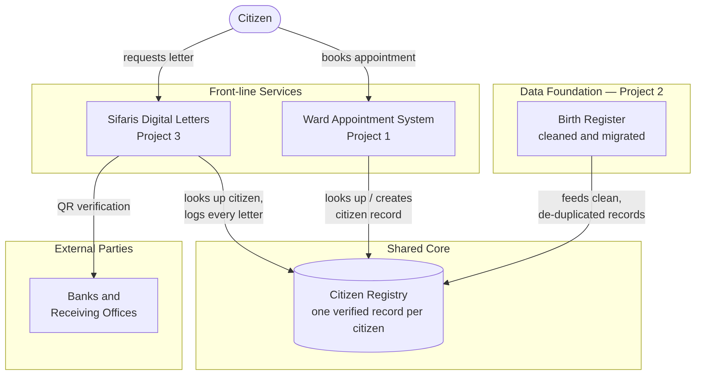

# Integration Architecture

> **In simple words:** a picture showing how the three systems (birth register, appointment booking, sifaris letters) would share one citizen record instead of each keeping its own.

## How to read it

- **Birth Register** (Project 2) is the data foundation — it feeds the first clean, de-duplicated citizen records into the shared Citizen Registry.
- **Ward Appointment System** (Project 1) and **Sifaris Digital Letters** (Project 3) both look up — and, where needed, create — a citizen's record in the same registry instead of keeping their own separate copies.
- **Banks and receiving offices** verify a sifaris letter by scanning its QR code, which checks against the shared registry.

## Why one shared registry instead of three separate databases

| Keeping three separate databases | One shared Citizen Registry |
|---|---|
| A citizen's name/phone might be spelled three different ways across systems | One verified record, looked up by every system |
| No single place to check if a citizen's details are correct | Corrections made once, visible everywhere |
| Fraud or duplicate records are harder to catch across systems | A duplicate or suspicious record is visible to all three systems at once |
| Each system re-solves "who is this person" from scratch | Birth Register migration (Project 2) already solved this once, and the fix is reused |

---
*Diagram source (for editing): [integration-architecture.mmd.txt](integration-architecture.mmd.txt) — paste into [mermaid.live](https://mermaid.live) if you ever need to change it.*
