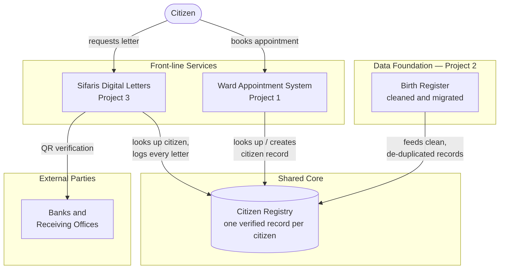

# Municipal Digital Services — Business Case & Integration Blueprint

*A self-initiated systems analysis by Basant Tamang, synthesising three earlier case studies (Birth Register Migration, Ward Appointment System, Sifaris Digital Letters) into one integration proposal.*

## Executive Summary

Three separate case studies in this portfolio each solved one municipal ward-office problem on its own: cleaning and migrating birth records (Project 2), booking ward appointments (Project 1), and issuing recommendation letters, or *sifaris* (Project 3). Each works, but each also keeps its own copy of who a citizen is. This document makes the business case for connecting them through one **shared Citizen Registry**, so a citizen's verified details are entered once and reused everywhere, instead of being re-typed, re-verified, and occasionally mismatched across three systems.

The proposed integration costs an estimated **NPR 2,400,000** to build (48 person-weeks) and **NPR 600,000/year** to run, against an estimated **NPR 3,375,000/year** in citizen time saved by avoiding unnecessary return trips — a simple payback period of **about 11 months**. Beyond the money, it closes a real risk already visible in the existing projects: duplicate or mismatched citizen records are harder to catch when three systems never compare notes.

The recommended path is **not** to build everything at once. It is sequenced in three phases — a low-cost pilot, a one-system connection, and full three-way integration — so the ward office gets a working improvement within weeks rather than waiting a year for a single big release.

## 1. Context

This portfolio contains three independent case studies, each addressing one part of a citizen's journey through the ward office:

| Project | What it does | What it already knows about a citizen |
|---|---|---|
| **Project 2** — Birth Register Migration | Cleans and migrates decades of paper-era birth records into one de-duplicated database | Name, date of birth, parents' names, registration number |
| **Project 1** — Ward Appointment System | Lets citizens book a time slot for a ward-office service instead of queueing | Name, phone number, service requested |
| **Project 3** — Sifaris Digital Letters | Issues and QR-verifies recommendation letters for banks and other receiving organisations | Name, citizenship/registration number, letter purpose |

Each project was scoped, designed, and delivered as its own unit — correctly, since trying to solve all three at once would have delayed every one of them. Now that all three exist, the next question a System Analyst should ask is: **do they need to talk to each other, and is it worth the cost of making them?**

## 2. The Problem

None of the three systems currently shares a citizen record with the others. In practice, that means:

1. **The same citizen is re-entered three times.** A citizen whose birth record was just cleaned in Project 2 still has to give their name and details again when booking an appointment (Project 1) and again when requesting a sifaris letter (Project 3).
2. **Small mismatches are invisible across systems.** A name spelled slightly differently in one system than another is not flagged, because nothing compares the three records to each other.
3. **A citizen's visit to one service gives no advance notice to the next.** If a citizen books an appointment in Project 1 specifically to collect a sifaris letter, Project 3 has no way of knowing that in advance.
4. **Fraud and duplicate-identity checks are weaker than they could be.** Project 2's birth-register work already solved "is this the same person as that other record?" once, at real effort — but that solved problem is not reused by the other two systems.

None of this is a defect in any single project. It is the natural limit of building three systems independently, and it is exactly the kind of gap a System Analyst is expected to notice and size up — not just design one system well, but see how systems should work together.

## 3. Objective

Propose, cost, and sequence an integration that lets Projects 1, 2 and 3 share one verified citizen record, so that:

- A citizen's details are entered and corrected **once**, not up to three times
- Each system can detect a likely duplicate or mismatch by checking the shared registry, rather than only within its own data
- A future service can be added to the municipality's digital offerings without re-solving "who is this citizen" from scratch

## 4. Proposed Integrated Architecture

The proposal is a single **Citizen Registry** sitting at the centre, seeded by the clean data from the Birth Register Migration (Project 2), and looked up — not duplicated — by the two front-line services.

**How it works, in short:**

- **Birth Register (Project 2)** feeds the first batch of clean, de-duplicated citizen records into the registry. This reuses work already done rather than starting over.
- **Ward Appointment System (Project 1)** looks up a citizen's record when booking starts, and creates one if it's genuinely new — rather than keeping its own separate list of names and phone numbers.
- **Sifaris Digital Letters (Project 3)** looks up the same registry to verify who it's issuing a letter for, and logs that every letter was linked to a real, checked citizen record.
- **Banks and receiving organisations** verify a letter's QR code, which checks against the same shared registry — so a forged or duplicate letter is easier to catch.

Full diagram source is in [`diagrams/integration-architecture.md`](../diagrams/integration-architecture.md) (and its editable Mermaid source, for anyone who wants to adjust the diagram).

## 5. Cost-Benefit Analysis

Worked figures are in [`analysis/cost-benefit-model.csv`](../analysis/cost-benefit-model.csv). Summary:

| Item | Value |
|---|---|
| Annual ward-office visits across the three services | 150,000 |
| Visits currently requiring an avoidable return trip (system down / wrong room / officer absent / re-entering details) | ~20% (30,000 visits/year) |
| Time saved per avoided return trip | 45 minutes |
| Value of citizen time (conservative local estimate) | NPR 150/hour |
| **Annual citizen benefit** | **NPR 3,375,000/year** |
| One-time integration build cost (48 person-weeks × NPR 50,000/week) | NPR 2,400,000 |
| Annual operating cost (hosting, maintenance, support) | NPR 600,000/year |
| **Simple payback period** | **~11 months** |

From Year 2 onward, the net annual benefit to citizens (time saved, less ongoing running cost) is approximately **NPR 2,775,000/year**. This is a citizen-time saving, not a direct cash saving to the municipality — the business case for it rests on service-quality and trust improvements as much as on the arithmetic, and the figures above should be treated as planning estimates, not audited numbers.

### 5.1 What this estimate does not include

To stay conservative and honest, this estimate leaves out some real but harder-to-quantify benefits: fewer duplicate-identity fraud cases, faster staff processing time, and the value of citizens trusting the ward office more. Including those would likely shorten the payback period further, not lengthen it.

## 6. Sequencing and Stakeholder Recommendation

Building all three integrations simultaneously would be the highest-risk, slowest-to-prove option. The recommended path is phased:

| Phase | What happens | Why this order |
|---|---|---|
| **Phase 1 — Quick win (2–3 weeks)** | Stand up the shared Citizen Registry seeded from the already-cleaned Project 2 birth-register data. No other system changes yet. | Lowest risk: it reuses data that is already clean, and nothing citizen-facing changes yet, so it can be verified quietly before anything depends on it. |
| **Phase 2 — Pilot (4–6 weeks)** | Connect Project 1 (Ward Appointment System) to the registry: bookings look up and create citizen records there instead of a separate list. | Project 1 is the citizen's first touchpoint and has the smallest, best-understood data model of the two front-line systems — a safer first integration than the letter-issuing system. |
| **Phase 3 — Full integration (remaining ~6–8 weeks)** | Connect Project 3 (Sifaris Digital Letters) to the same registry, including the bank/receiving-organisation QR verification path. | Sifaris letters carry more legal and financial weight (they are relied on by banks), so this step comes last, once the registry has already proven itself in Phase 2. |

This sequencing means the ward office sees a working improvement after Phase 1–2 (roughly 6–9 weeks), rather than waiting for one large release at the end of 48 person-weeks.

## 7. RACI Matrix

| Activity | Ward Office Management | System Analyst (this project) | Developer(s) | IT/Hosting | Banks / Receiving Orgs |
|---|---|---|---|---|---|
| Approve integration business case | **A** | R | C | I | I |
| Design shared Citizen Registry schema | C | **A/R** | C | I | — |
| Migrate Project 2 data into registry (Phase 1) | I | **A/R** | C | C | — |
| Integrate Project 1 booking flow (Phase 2) | C | **A** | **R** | C | — |
| Integrate Project 3 letter flow (Phase 3) | C | **A** | **R** | C | I |
| Sign off on QR verification change for receiving organisations | **A** | R | C | I | **C** |
| Operate and maintain shared registry post-launch | I | C | C | **A/R** | — |

*R = Responsible, A = Accountable, C = Consulted, I = Informed.*

## 8. Integration-Specific Risks

| Risk | Likelihood | Impact | Mitigation |
|---|---|---|---|
| Merging three systems' data surfaces previously-hidden duplicate or mismatched citizen records | High | Medium | Expected, not a defect — run a manual review queue (already built for Project 2) rather than auto-merging; treat conflicts as a data-quality finding |
| A single shared registry becomes a single point of failure for all three services | Medium | High | Each front-line system keeps a local cache and the same printable-fallback pattern already built for Project 1 downtime |
| Phase 3's bank-facing QR change requires external sign-off outside the ward office's control | Medium | Medium | Sequenced last (Section 6) and flagged to receiving organisations early, not as a surprise at go-live |
| Estimated effort (48 person-weeks) assumes familiarity with all three existing codebases | Low | Medium | All three systems were built with the same documentation standard, reducing ramp-up time for whoever implements this |

## 9. Recommendation and Next Steps

1. Approve Phase 1 (shared Citizen Registry seeded from Project 2 data) as a low-risk, low-cost first step — no citizen-facing system changes required.
2. Use Phase 1 as the checkpoint to confirm the cost-benefit estimates in Section 5 before committing to Phases 2–3.
3. Proceed to Phase 2 (Ward Appointment System integration) only after Phase 1 is verified in production.
4. Brief banks and other receiving organisations early about the Phase 3 QR-verification change, well ahead of implementation.

## Sources

This business case is built entirely from data and designs already produced in the portfolio's three underlying case studies:

- Project 1 — [Ward Appointment System](https://github.com/basanttamang/ward-appointment-system): interview findings (pain points P8–P10), requirements, and architecture
- Project 2 — [Birth Register Migration](https://github.com/basanttamang/birth-register-migration): de-duplication approach and migration results
- Project 3 — [Sifaris Feasibility Study](https://github.com/basanttamang/sifaris-feasibility-study): options analysis, legal/policy review, and rollout plan

All cost and benefit figures in Section 5 are planning-level estimates created for this business case and should be validated against actual data before being used for budget approval.
